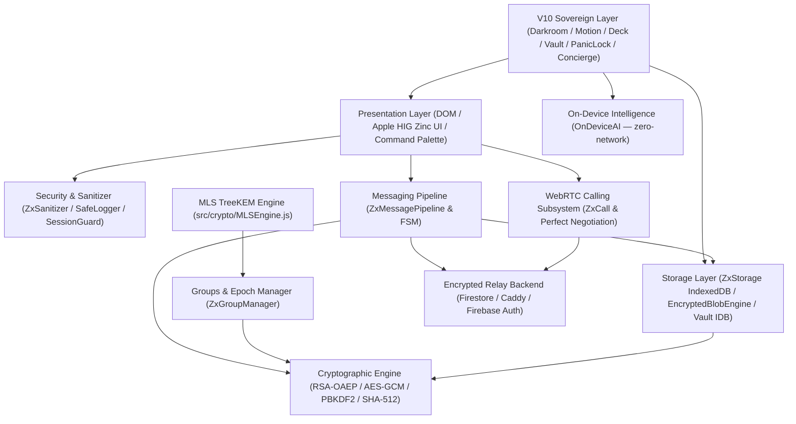
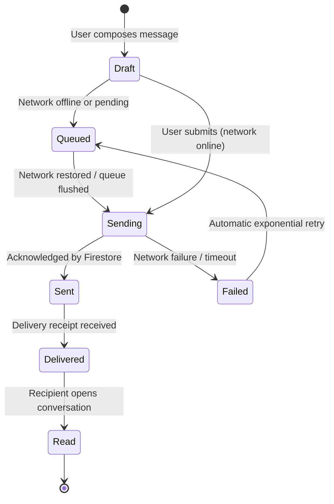

# 📐 Zyntrixly 10 System Architecture

**Codename:** The Sovereign Client  
**Release:** 10.0.0  
**Project:** zyntrix-kernel/Zyntrixly

---

## 1. System Overview

Zyntrixly 10 is a zero-knowledge, privacy-first **private OS in a browser tab**, built with a modular layered architecture. The V10 release adds the Sovereign Client layer — Design OS "Darkroom", Motion Core, Command Deck, Vault, Panic Lock, and on-device Concierge — as a strictly additive layer over the proven messaging core.



---

## 2. Directory & Module Organization

```text
src/
  types/
    index.ts                  # Master TypeScript models and declarations
  crypto/
    CryptoEngine.js           # Multi-device identities, safety numbers, key epochs
    MLSEngine.js              # TreeKEM group ratcheting, epoch forward secrecy
    WebAuthnPRF.js            # Passkey-derived master keys (hardware PRF)
  messaging/
    MessagePipeline.js        # Lifecycle FSM, deduplication, offline queue
  storage/
    IndexedDBStore.js         # Messages, outbox, call history, key store
    EncryptedBlobEngine.js    # Client-side AES-GCM file encryption & object URLs
  groups/
    GroupManager.js           # RBAC, invitations, and cryptographic epoch ratchets
  security/
    sanitizer.js              # Universal strict DOM and text sanitizer
  search/
    SearchIndex.js            # Client-side decrypted full-text search engine
  ai/
    OnDeviceAI.js             # Zero-network summarizer + semantic search
  spaces/
    SpaceManager.js           # Communities, channels, RBAC
  media/
    StageController.js        # Call layout stages
  config/
    appConfig.js              # Centralized environment and operational limits
  styles/
    v10.css                   # Design OS "Darkroom" — token override layer
  v10/                        # THE SOVEREIGN CLIENT LAYER (V10)
    MotionEngine.js           # GSAP motion core — boot, screens, bubbles, decryptText
    CommandDeck.js            # Command Deck v2 — fuzzy, grouped, keyboard-first
    Vault.js                  # Encrypted file vault (ZxBlobEngine + IndexedDB)
    PanicLock.js              # Instant lock, re-auth unlock, idle auto-lock
    Concierge.js              # On-device AI drawer
    boot.js                   # V10 wiring — dock, shortcuts, observers
scripts/
  validate_setup.js           # Automated pre-flight deployment diagnostic CLI
  vendor-gsap.js              # postinstall: copies GSAP into vendor/gsap (self-hosted)
tests/
  crypto.test.js              # RSA, AES, PBKDF2, safety numbers, epochs
  security.test.js            # Safe logger, KeyStore, SessionGuard, sanitizer
  firestore_rules.test.js     # Authorization rules verification
  messaging_pipeline.test.js  # Offline storage, outbox, reaction toggling
  dom_integrity.test.js       # Preservation of 146 baseline element IDs
  webrtc.test.js              # Calling state machine and tracks
  calling_auth.test.js        # Timeouts and auth synchronization
  e2e_features.test.js        # Full Puppeteer Chrome end-to-end journeys
  run_all_tests.js            # Master test runner (100% pass gate)
vendor/
  gsap/gsap.min.js            # GSAP 3.13 — vendored at npm install (jsDelivr fallback on raw checkouts)
```

### V10 Load Chain (strictly ordered)

```text
index.html (head)          → vendor/gsap/gsap.min.js (jsDelivr fallback) + src/styles/v10.css
index.html (loader IIFE)   → app.js → webrtc.js → src/v10/{MotionEngine, CommandDeck,
                             Vault, PanicLock, Concierge, boot}.js
```

The V10 layer loads strictly after the app core so it can wrap entry points
(`openCommandPalette`, `showScreen`) without patching core files. The theme is
gated on `html[data-v10="10"]` — removing that attribute (or the V10 script
chain) restores the legacy client unchanged.

---

## 3. Communication Engine Lifecycle



---

## 4. WebRTC Calling & Media Subsystem

- **Signaling Channel:** Encrypted Firestore signaling via `calls/{callId}` with participant authorization rules.
- **Negotiation Pattern:** Standard WebRTC Perfect Negotiation pattern handling polite and impolite peers.
- **Relay Fallback:** STUN discovery with automatic TURN relay integration and ICE restart on disconnects.
- **Privacy:** Call history is logged purely client-side in IndexedDB `call_history`; no persistent call logs remain on the server.
