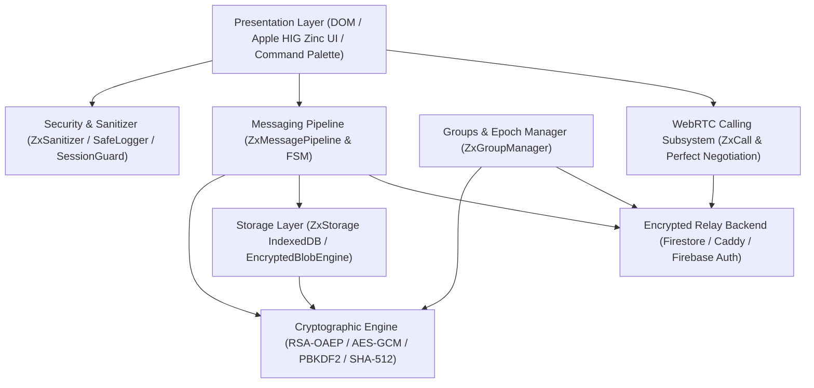
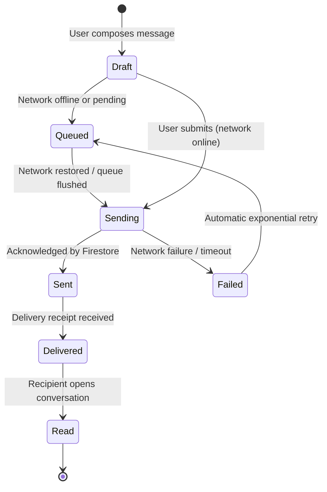

# 📐 Zyntrixly 2.0 System Architecture

**Codename:** Zyntrixly Evolution  
**Release:** 2.0.0  
**Project:** zyntrix-kernel/Zyntrixly

---

## 1. System Overview

Zyntrixly 2.0 is a zero-knowledge, privacy-first communication platform built with a modular layered architecture.



---

## 2. Directory & Module Organization

```text
src/
  types/
    index.ts                  # Master TypeScript models and declarations
  crypto/
    CryptoEngine.js           # Multi-device identities, safety numbers, key epochs
  messaging/
    MessagePipeline.js        # Lifecycle FSM, deduplication, offline queue
  storage/
    IndexedDBStore.js         # Messages, outbox, call history, key store
    EncryptedBlobEngine.js    # Client-side AES-GCM file encryption & object URLs
  groups/
    GroupManager.js           # RBAC, invitations, and cryptographic epoch ratchets
  security/
    sanitizer.js              # Universal strict DOM and text sanitizer
  search/
    SearchIndex.js            # Client-side decrypted full-text search engine
  config/
    appConfig.js              # Centralized environment and operational limits
scripts/
  validate_setup.js           # Automated pre-flight deployment diagnostic CLI
tests/
  crypto.test.js              # RSA, AES, PBKDF2, safety numbers, epochs
  security.test.js            # Safe logger, KeyStore, SessionGuard, sanitizer
  firestore_rules.test.js     # Authorization rules verification
  messaging_pipeline.test.js  # Offline storage, outbox, reaction toggling
  dom_integrity.test.js       # Preservation of 146 baseline element IDs
  webrtc.test.js              # Calling state machine and tracks
  calling_auth.test.js        # Timeouts and auth synchronization
  e2e_features.test.js        # Full Puppeteer Chrome end-to-end journeys
  run_all_tests.js            # Master test runner (100% pass gate)
```

---

## 3. Communication Engine Lifecycle



---

## 4. WebRTC Calling & Media Subsystem

- **Signaling Channel:** Encrypted Firestore signaling via `calls/{callId}` with participant authorization rules.
- **Negotiation Pattern:** Standard WebRTC Perfect Negotiation pattern handling polite and impolite peers.
- **Relay Fallback:** STUN discovery with automatic TURN relay integration and ICE restart on disconnects.
- **Privacy:** Call history is logged purely client-side in IndexedDB `call_history`; no persistent call logs remain on the server.
